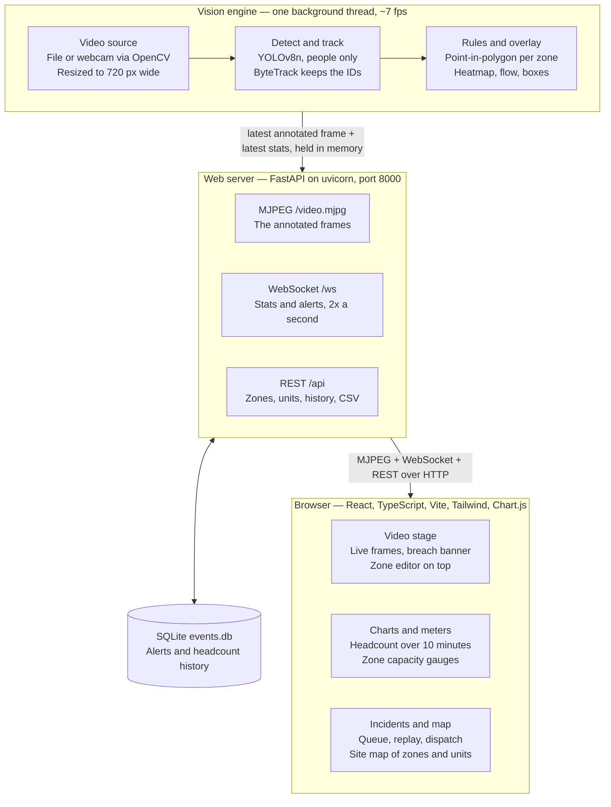

# SENTINEL — architecture

Crowd density and bottleneck analytics (**Track A**) combined with incident triage
and response dispatch (**Track B**), in one operator console.

The two tracks merge because they need the same geometry. Congestion asks whether a
zone's occupancy is above its capacity; intrusion asks whether it is above zero.
Same point-in-polygon test, one flag on the zone.

---

## System diagram



The separation that matters: the vision engine is a **producer** running in its own
thread, and every web endpoint is a **consumer** that reads whatever it produced most
recently. No request ever waits for a frame to be analysed, which is why the dashboard
stays responsive at ~7 fps.

---

## Modules

| File | Responsibility |
| --- | --- |
| `backend/vision.py` | Loading the model, reading frames, detection and tracking |
| `backend/zones.py` | Zone geometry and the four incident rules |
| `backend/overlay.py` | Heatmap, movement arrows, boxes, status strip |
| `backend/pipeline.py` | The background thread that joins the above together |
| `backend/database.py` | SQLite schema, writes, queries, CSV export |
| `backend/server.py` | Every HTTP and WebSocket endpoint |
| `backend/autozone.py` | Proposing a zone from the busiest part of the footage |
| `backend/tasks.py` | Background job wrapper for auto-zoning |
| `run.py` | Reads config, builds the three pieces, starts the server |
| `frontend-src/` | React source, compiled by Vite into `frontend/` |

---

## The vision pipeline

1. **Read a frame.** `VideoSource` wraps OpenCV's `VideoCapture`. On Windows it tries
   DirectShow first, then MSMF, then any backend — the default order gives black frames
   on many laptop webcams — and discards the first ten frames while auto-exposure settles.
2. **Resize to `process_width`** (720 px). Cheaper to draw and to stream. Note this is
   *not* the speed lever: measured, it buys about 6%, because the detector resizes
   internally anyway.
3. **Detect people.** YOLOv8n filtered to COCO class 0. Nano because the whole system has
   to run on a laptop CPU during a live call. `imgsz` (512) is the real speed/accuracy
   control — the square the detector resizes to internally.
4. **Track.** `model.track(persist=True)` with ByteTrack. Detection alone gives a count;
   tracking gives stable IDs, and dwell time is *now* minus the moment that ID entered the
   zone. ByteTrack keeps low-confidence boxes as tracking candidates, which is what holds
   IDs through partial occlusion. Requires `lap`, which ultralytics does not install itself.
5. **Locate each person.** Position is the **bottom-centre of the bounding box** — the feet,
   the point touching the ground — not the box centre, which is roughly chest height and
   floats in mid-air. Tested with `cv2.pointPolygonTest`.
6. **Draw the overlay.** Heatmap, movement arrows, boxes, status strip, then JPEG encode.
   The heatmap is accumulated and blurred at **quarter resolution** and scaled up: full
   resolution cost 64.7 ms per frame (49.8% of frame time), quarter costs 16.4 ms, with no
   visible difference because blur destroys the detail anyway.

---

## The rules engine

A zone is a polygon, a capacity, and a `restricted` flag.

| Rule | Fires when | Severity | Track |
| --- | --- | --- | --- |
| `CONGESTION` | Occupancy goes above the zone's capacity | Critical | A |
| `INTRUSION` | Anyone at all is inside a restricted zone | Critical | B |
| `DWELL` | One tracked person stays past the dwell limit | Warning | A |
| `CLEARED` | A breached zone drops back within limits | Info | A |

The entire merge between the two tracks:

```python
if zone.restricted:
    breached = count > 0              # INTRUSION  (Track B)
else:
    breached = count > zone.capacity  # CONGESTION (Track A)
```

- **`CLEARED` is edge-triggered** via a `was_breached` flag, so the log records the
  transition rather than one row per calm frame.
- **Alerts have a cooldown.** `_cooldown_passed()` suppresses repeats of the same alert
  type for the same zone within a time window — directly the rubric's "low false positives".
- **Dwell depends on the tracker.** `entry_times` is keyed by track ID; lose the ID and
  dwell resets.

### Why polygons, and nothing else

There is no circle, rectangle or square type in the backend. Those editor buttons are
drawing conveniences that all produce an ordered list of points; a circle is stored as a
32-sided polygon. A camera flattens 3D space by perspective projection, so a rectangular
patch of floor appears on screen as a **trapezoid** — a screen-aligned rectangle cannot
follow real ground. One geometry type reaches the rules engine.

### Dispatch

`nearest_unit()` takes the breached zone's centroid, filters units to those marked
available, and returns the closest by straight-line distance. This is a **simulation**,
as the brief specifies: pixel distance on the camera view, not routing on a street map.

---

## API

| Endpoint | Transport | Purpose |
| --- | --- | --- |
| `/video.mjpg` | MJPEG | Annotated frame stream |
| `/ws` | WebSocket | Live stats, occupancy and new alerts, 2x a second |
| `/api/zones` | GET / POST | Read zones; save drawn zones and apply without restart |
| `/api/zones/auto` | POST | Analyse footage and propose a zone over the busy area |
| `/api/units` | GET / POST | Read and save response units placed on the site map |
| `/api/alerts` | GET | Incident log |
| `/api/alerts/{id}/suggest` | GET | Nearest available unit to this incident |
| `/api/alerts/{id}/dispatch` | POST | Assign a unit and record it |
| `/api/alerts/{id}/status` | POST | Acknowledge or resolve |
| `/api/history` | GET | Headcount samples for the time-series chart |
| `/api/summary` | GET | Peak, event count, criticals, open incidents |
| `/api/export.csv` | GET | Whole log as CSV |
| `/api/videos` | GET / POST | List, upload and switch video source |
| `/api/playback/*` | POST | Pause, restart, seek |
| `/api/heatmap`, `/api/flow` | POST | Toggle overlays live |

**Three transports, deliberately.** Video is a continuous byte stream, so MJPEG — no
decoding, no player library, an `` tag renders it. Stats change twice a second and
the server knows when, so WebSocket push. Everything else is a question with an answer,
so REST.

**Storage.** SQLite with `check_same_thread=False` and a lock, because the pipeline thread
writes while web requests read. Migrations read `PRAGMA table_info` and add missing
columns, so an older `events.db` still opens.

---

## Stack, against the brief's suggestions

| Layer | Brief's examples | Used here |
| --- | --- | --- |
| Vision and ML | OpenCV, PyTorch, MediaPipe, YOLO, ByteTrack / DeepSORT, EasyOCR / PaddleOCR | OpenCV, PyTorch (via ultralytics), YOLOv8n, ByteTrack |
| Backend and data | FastAPI / Flask / Node.js; WebSockets, WebRTC, MJPEG; SQLite or PostgreSQL | FastAPI, WebSockets, MJPEG, SQLite |
| Web interface | React / Next.js / Vue; Tailwind CSS, shadcn/ui; Recharts / Chart.js / Leaflet | React, Tailwind CSS, Chart.js |

Modular inference, configurable confidence thresholds, tracking settings and FPS controls
all live in `config.json` with an explanatory note beside each, rather than hard-coded.

**Leaflet is deliberately not used.** It would be correct for GPS-tagged data. This
footage has no coordinates — a fixed camera looking at a plaza — so pinning it to a world
map would mean inventing a location, and map tiles need the internet, which makes a demo
fail for no reason. The site map draws the scene's own geometry instead: zones where they
actually are in the camera's view, units at their posts, and a line from a dispatched unit
to its incident.

---

## Observed limitations

- Dispatch is **simulated**; distance is straight-line in pixels, not routed travel time.
- **YOLOv8n is the least accurate model in its family**, chosen for CPU speed during a live
  demo. Distant and heavily occluded people are missed. `yolov8s` or a higher `imgsz` trades
  frame rate for recall — both are one line in `config.json`.
- **One camera, no re-identification.** Someone who leaves and returns is a new track ID.
- **Counts are instantaneous, not smoothed.** A one-frame flicker moves the count for that
  frame; the alert cooldown stops it becoming a flood of incidents, but the number can jitter.
- **Zone coordinates are tied to the frame width they were drawn at.** `zones_frame_width` is
  recorded and geometry is rescaled on load, but the coupling exists.
- **No authentication, single operator, localhost.**
- **CPU only.** No GPU path; the same code on a CUDA machine would run several times faster.

Measured on the development laptop: ~6.7 fps, ~149 ms per frame.
