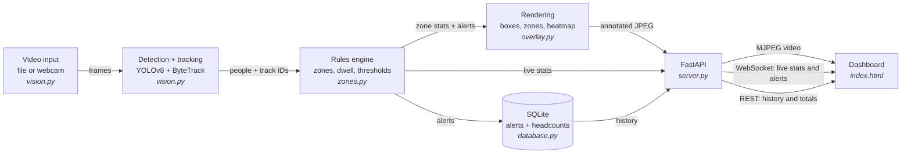

# SENTINEL — Crowd Density and Incident Response

**Track A + Track B** submission for the Cogno Valley Labs Vision AI internship.

An operator console that watches a camera feed, counts how many people are
inside each configured zone, measures how long they stay, raises an incident
when a zone is breached, and lets the operator dispatch a response unit to it.

## Why these two tracks merge cleanly

The brief permits combining "related tracks in a single platform". A and B are
related in the strongest possible sense: **they need the same geometry.**

Track A asks "how many people are inside this zone, and is that too many?"
Track B's intrusion incident asks "is anyone inside this zone at all?" Both are
a point-in-polygon test against a person's feet. So Track B's detection is a
single flag on a zone — `restricted: true` — and not one line of new vision
code. What B adds on top is the thing A lacks: an **operator workflow**.

| Zone kind | Rule | Incident |
|---|---|---|
| Normal | occupancy > capacity | `CONGESTION`, critical |
| Restricted | occupancy > 0 | `INTRUSION`, critical |
| Either | one person past the dwell limit | `DWELL`, warning |
| Either | a breached zone returns to normal | `CLEARED`, info |

---

## What it does

| Core build scope (from the brief) | Where it lives |
|---|---|
| Detect and track people; count occupancy within configured zones | `backend/vision.py`, `backend/zones.py` |
| Generate density heatmaps and estimate movement | `HeatmapAccumulator` and `FlowField` in `backend/overlay.py` |
| Measure dwell time and alert when a zone exceeds capacity | `backend/zones.py` |

| Dashboard requirement | Where it lives |
|---|---|
| Live video with density heatmap and bounding boxes | `/video.mjpg` → `frontend/index.html` |
| Zone capacity gauges and headcount time-series chart | right-hand rail and chart panel |
| Visible congestion banner when thresholds trigger | `.banner` in `frontend/index.html` |

### Track B scope

| Core build scope (from the brief) | Where it lives |
|---|---|
| Selected incident detection — **intrusion** | `restricted` zones in `backend/zones.py` |
| Incident evidence — "a 5-second clip **or a keyframe**" | the exact annotated keyframe, saved to `snapshots/` by `backend/pipeline.py` |
| Simulated dispatch — assign the nearest available unit | `ZoneManager.nearest_unit()`, units configured in `config.json` |

| Dashboard requirement | Where it lives |
|---|---|
| Priority incident queue, Critical / Warning / Info tags | the rail's incident queue, with severity filters |
| Instant replay — open the snapshot in a replay view | click any evidence thumbnail |
| Dispatch workflow — select a unit and show the assignment | `ACK` → `DISPATCH` → `RESOLVE` on each incident |

**How "nearest unit" works:** each unit in `config.json` has a position on the
camera view. When you dispatch, the backend measures straight-line distance
from the middle of the incident's zone to each available unit and suggests the
closest. It is a simulation, and the README says so rather than implying real
routing — but it is a *reasoned* choice, not a random one. An intrusion at the
Service Gate picks Gate Security; congestion on the Plaza picks Patrol 2.

Beyond the brief:

| Feature | Why it is there |
|---|---|
| **Zone editor** — draw zones onto the live video with polygon, rectangle, square or circle tools | Config becomes an operator feature, and the dashboard gets a write path rather than being read-only |
| **Playback controls** — pause, restart, scrub | A live demo can be driven to the exact moment an alert fires instead of waiting for the video to loop |
| **Evidence snapshots** — the annotated frame that triggered each alert, stored and shown as a thumbnail | The alert log is provable rather than just a line of text |
| **Presentation mode** — raises every type size and line weight | Screen sharing re-encodes at a low bitrate; 12px type is unreadable at the other end of a call |
| **CSV export** of the alert log | A reviewer can check the claims without running the code |
| **Alert markers on the chart** | The headcount graph and the alert feed become one story rather than two unrelated panels |
| **Portrait-aware layout** | Phone and CCTV footage is often 9:16; the chart moves beside the video so the screen isn't half black bars |

### Movement flow — how it works

Every tracked person has a position this frame and a position last frame. The
difference is their velocity. Average those velocities inside each cell of a
grid laid over the picture and you get the direction people travel through
each part of the scene. No extra model — it is arithmetic on track IDs the
system already has.

**Why it matters for bottlenecks:** a full zone tells you *that* there is a
problem. The flow field starts to tell you *why*. Arrows pointing into each
other are a crossing conflict; arrows that shorten approaching a doorway mean
people are slowing down — a queue forming before any count has gone over its
limit.

---

## Quick start

You need **Python 3.9 or newer**. Check with `python --version`.

```bash
# 1. Go into the project folder
cd crowd-analytics

# 2. Create an isolated environment so these packages don't affect
#    anything else on your machine
python -m venv .venv

# 3. Turn it on
#    Windows:
.venv\Scripts\activate
#    macOS / Linux:
source .venv/bin/activate

# 4. Install the packages
pip install -r requirements.txt

# 5. Put a video at data/demo.mp4  (see "Demo data" below)

# 6. Run it
python run.py
```

Then open **http://localhost:8000** in your browser, and draw your zones —
see the next section.

The YOLO model ships in `models/`, so this runs with **no internet
connection**, which is what you want during a live demo.

> **Use a video file, not your webcam, for an online interview.** Zoom, Meet
> and Teams hold the camera to show your face, so the app cannot have it at
> the same time. To test with a webcam anyway, set `"source": 0` in
> `config.json`, and run `python tools/test_camera.py` first if the picture
> comes out black — on Windows that is usually OpenCV's Media Foundation
> backend, which `vision.py` now avoids in favour of DirectShow.

See **DEMO_SCRIPT.md** for the full walkthrough plan.

---

## Setting up your zones

**Zones start empty on purpose.** A placeholder rectangle would never line up
with your footage. Draw your own, in the browser, on the actual video:

1. Run the app and open the dashboard.
2. Click **Edit zones**. The video pauses automatically — drawing onto moving
   video is needlessly hard.
3. Pick a tool: **Polygon**, **Rectangle**, **Square** or **Circle**.
4. Polygon: click each corner, then double-click or press Enter to close it.
   The others: drag to draw.
5. Name it and set a capacity. **Use 2 or 3**, so an alert actually fires
   during a short demo.
6. Drag any corner to adjust. Double-click inside a zone to rename it.
7. **Save zones** — they apply immediately, with no restart, and are written
   back to `config.json` so they survive one.

### Why every shape is stored as a polygon

There is no "circle zone" or "rectangle zone" anywhere in the backend. A
camera flattens 3D space by perspective projection, so a rectangular patch of
floor appears on screen as a *trapezoid*. A polygon is the only shape that can
follow real ground. The rectangle, square and circle tools are drawing
conveniences that are converted to an ordered list of points before saving —
a circle becomes a 32-sided polygon — so `zones.py` only ever handles one kind
of geometry.

There is also an offline version, `python tools/draw_zones.py`, which opens an
OpenCV window instead. The browser editor is better in every way; the script
is kept for when you want to set zones without starting the server.

---

## Tuning it

Everything you can change is in `config.json`. The ones that matter most:

| Setting | What it does | When to change it |
|---|---|---|
| `confidence` | How sure YOLO must be before calling something a person | Lower it if people are being missed; raise it if objects are wrongly detected |
| `process_width` | Frames shrink to this width before detection | Lower to 640 if your laptop is slow |
| `frame_skip` | Process only every Nth frame | Set to 1 or 2 on a slow laptop |
| `dwell_alert_seconds` | How long one person can stand in a zone before a warning | Lower it to 8–10 so the alert fires during a short demo |
| `capacity` (per zone) | People allowed before a congestion alert | Set it low (3–5) so you can trigger it on camera |

---

## Performance — what was measured, and what actually mattered

The pipeline started at **7.7 fps**. Profiling each stage separately, rather
than guessing, found the cost was not where it looked:

| Stage | Before | After | |
|---|---|---|---|
| Heatmap | 64.7 ms | 16.4 ms | computed at ¼ resolution |
| Detection | 51.2 ms | ~30 ms | `imgsz` 640 → 512 |
| Read / encode / draw | 13.4 ms | ~8 ms | smaller display frame |
| **Total** | **130 ms (7.7 fps)** | **61 ms (16.5 fps)** | **2.2× faster** |

Three findings worth being able to explain:

1. **The heatmap cost more than YOLO did.** One Gaussian blur with a 22-pixel
   radius over a 960×1706 float array was half the frame budget. A heatmap is
   smooth blobs by definition — it has no fine detail to lose — so it is now
   computed on a quarter-size grid and stretched back up. Visually identical,
   about one sixteenth of the work.
2. **`process_width` is not the speed knob**, despite being the obvious
   candidate. Dropping it from 960 to 480 gained about 6%, because YOLO
   resizes to its own `imgsz` internally regardless. `imgsz` is the real
   control: 640 → 15 fps, 512 → 27 fps at *identical* detection counts,
   320 → 53 fps but now missing people. 512 is free speed; below it is not.
3. **Once `imgsz` governs accuracy, the display frame can shrink for free.**
   `process_width` 960 → 720 gained 59% with the same 12.6 people detected,
   because it only affects overlay drawing and encoding.

All figures measured on the project's own demo clip. Re-measure on yours —
the right `imgsz` depends on how small people are in the frame.

## Stack, against the brief's table

| Layer | The brief's examples | What this uses |
|---|---|---|
| Vision and ML | OpenCV, PyTorch, YOLO, ByteTrack | OpenCV, PyTorch, **YOLOv8n**, **ByteTrack** — modular inference, confidence and `imgsz` configurable, FPS reported live |
| Backend and data | FastAPI, WebSockets, MJPEG, SQLite | **FastAPI**, **WebSockets**, **MJPEG**, **SQLite** — REST for logs, WebSocket for events, MJPEG for video |
| Web interface | React, Tailwind, Chart.js, Leaflet | **React 19 + TypeScript**, **Vite**, **Tailwind v4**, **Chart.js** — responsive, live data binding, interactive chart and a schematic site map |

On Leaflet: it is the right tool for GPS-tagged data. This footage is a fixed
camera with no coordinates, so pinning it to a world map would be inventing a
location, and map tiles need internet that a live demo may not have. The site
map draws the scene's own geometry instead — zones where they are in the
camera's view, response units at their posts, and a line from a dispatched
unit to the incident it was sent to.

## Architecture



**The one design decision worth defending:** video processing runs in its own
background thread (`pipeline.py`), not inside the web request. The web layer
only ever reads the latest finished frame and the latest numbers from a
lock-protected shared object. This means the video is processed exactly once
no matter how many browsers are watching, and a slow frame never freezes the
page.

**Three transports, three jobs**, matching the brief's architecture table:

- **MJPEG** carries the video — a continuous stream of JPEG frames.
- **WebSocket** pushes live counts and alerts, so the dashboard updates with
  no page refresh.
- **REST** serves history — past alerts and the headcount chart on page load.

---

## File guide

```
crowd-analytics/
├── run.py                  start everything; the only file you run
├── config.json             every setting, with notes
├── requirements.txt        Python packages and their licences
├── DEMO_SCRIPT.md          minute-by-minute script for the live walkthrough
│
├── backend/                Python — FastAPI + the vision pipeline
│   ├── vision.py           reads frames; finds and tracks people
│   ├── zones.py            occupancy, dwell, intrusion, alert rules
│   ├── autozone.py         proposes a zone from observed foot traffic
│   ├── overlay.py          heatmap, movement flow, boxes, zone shapes
│   ├── database.py         SQLite: incidents, headcounts, dispatch state
│   ├── pipeline.py         the background loop that joins the above
│   ├── tasks.py            background jobs (zone analysis)
│   └── server.py           REST + WebSocket + MJPEG endpoints
│
├── frontend-src/           React + TypeScript source (Vite + Tailwind)
│   ├── src/App.tsx         composition and state
│   ├── src/api.ts          every backend call, in one place
│   ├── src/types.ts        the shapes the backend sends
│   ├── src/hooks/useLiveData.ts   one WebSocket, shared by every panel
│   └── src/components/     BootScreen, MatrixRain, VideoStage, ZoneMeters,
│                           IncidentQueue, HeadcountChart, SiteMap, Controls
│
├── frontend/               COMPILED output, served by FastAPI
│
├── tools/
│   ├── test_camera.py      find a webcam index and backend that works
│   ├── draw_zones.py       offline zone drawing (the browser editor is better)
│   └── frames_to_video.py  turn a MOT17/MOT20 frame folder into an .mp4
│
├── data/                   demo videos (uploads land here too)
├── models/                 YOLO weights (yolov8n.pt ships with this repo)
└── snapshots/              evidence frames, written at runtime
```

### Building the front end

**You do not need Node to run this project.** `frontend/` holds the compiled
bundle and is committed, so `python run.py` is enough.

To change the interface:

```bash
cd frontend-src
npm install
npm run build      # writes straight into ../frontend
```

`npm run dev` gives hot reload and proxies the API to the Python backend on
port 8000, so the interface can be developed against the real pipeline.


### API

| Method | Path | Purpose |
|---|---|---|
| GET | `/video.mjpg` | annotated video stream |
| WS | `/ws` | live stats, alerts and playback position |
| GET | `/api/alerts` `/api/history` `/api/summary` | history for the page |
| GET | `/api/units` | response units available for dispatch |
| GET | `/api/alerts/{id}/suggest` | nearest unit to that incident, with distance |
| POST | `/api/alerts/{id}/status` | NEW → ACKNOWLEDGED → DISPATCHED → RESOLVED |
| POST | `/api/alerts/{id}/dispatch` | assign a unit (nearest, if none named) |
| GET / POST | `/api/zones` | read zones; save and hot-reload new ones |
| GET | `/api/playback` | current position and paused state |
| POST | `/api/playback/pause` `/seek` `/restart` | drive the video |
| POST | `/api/heatmap` `/api/flow` | toggle the overlays |
| GET | `/api/export.csv` | download the alert log |
| GET | `/snapshots/<file>` | evidence frame for one alert |

---

## Demo data and validation

The brief asks for a demo dataset plus evidence of how it behaves. Record
three short clips:

1. **The trigger clip** — enough people walk into a zone to exceed its
   capacity. The count rises, the heatmap reddens, the banner appears.
2. **The dwell clip** — one person stands still in a zone past the time
   limit, producing a warning.
3. **The quiet clip** — normal activity that stays under capacity. This is
   the one that shows you checked for **false positives**, which the brief
   asks for explicitly.

Note the observed figures from the status bar on your own hardware
(frames per second and milliseconds per frame) and write them into
`data/README.md` alongside what each clip should produce.

### Known limitations — say these before the panel finds them

- People heavily overlapping in a crowd are sometimes merged into one
  detection, so counts under-read at high density.
- A track ID can change if a person is hidden behind a pillar for several
  seconds, which restarts their dwell timer.
- Occupancy uses the person's feet position against a flat polygon. It has no
  real sense of depth, so a person far away standing "behind" a zone in 3D can
  read as inside it on screen.
- On CPU this runs at roughly 8–15 fps at 960px width. It is not real-time at
  full frame rate without a GPU.

---

## Licences

The brief requires an all-open-source stack with documented licences.

| Component | Licence | Note |
|---|---|---|
| Ultralytics YOLOv8 (code + `yolov8n.pt` weights) | **AGPL-3.0** | Copyleft. Fine for this coursework submission. A commercial product would need an Ultralytics commercial licence or a permissively licensed detector. |
| OpenCV | Apache-2.0 | |
| FastAPI | MIT | |
| Uvicorn | BSD-3-Clause | |
| NumPy | BSD-3-Clause | |
| lap (ByteTrack matching) | BSD-2-Clause | |
| python-multipart | Apache-2.0 | video uploads |
| React | MIT | |
| Vite | MIT | |
| Tailwind CSS | MIT | |
| Chart.js + react-chartjs-2 | MIT | |
| TypeScript | Apache-2.0 | |
| Demo footage | Pexels Licence | free for personal and commercial use, no attribution required |

No proprietary or paid vision APIs are used anywhere in this project.

---

## Troubleshooting

**`Could not open the video source`** — the path in `config.json` is wrong.
It is relative to the project folder, so `data/demo.mp4` means
`crowd-analytics/data/demo.mp4`.

**The page loads but the video area is blank** — the first frame takes a few
seconds while the model loads. If it stays blank, look at the terminal for an
error.

**It runs very slowly** — set `"process_width": 640` and `"frame_skip": 2` in
`config.json`.

**No alerts ever fire** — your zone capacities are too high for the number of
people in the video. Lower `capacity` to 2 or 3 and restart.
